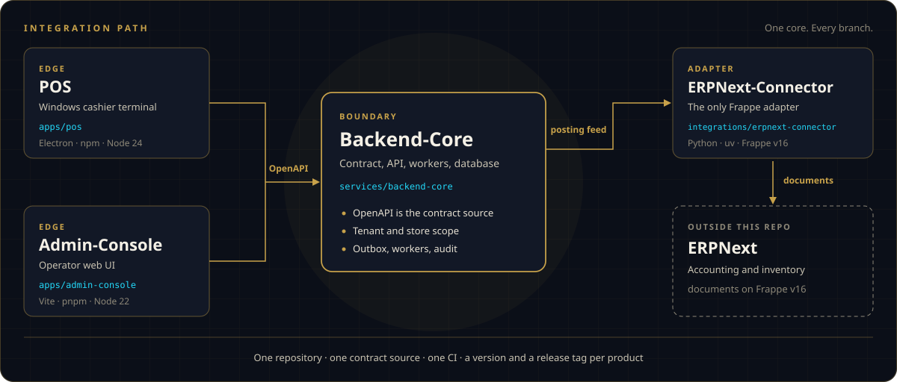

<p align="center">
  
  <br>
  <sub>One tower. Every branch.</sub>
</p>

<div align="center">

# Retail Tower

**Control every branch from one secure core.**

Four products. One repository. One contract. One path to ERPNext.

[](https://coderabbit.ai)
[](https://codescene.io/projects/86856)
[](https://codescene.io/projects/86856)
[](LICENSE)

<br>

[Platform](#the-platform) · [Start here](#start-here) · [Boundaries](#boundaries) · [Pull requests](#how-a-pull-request-is-proved) · [Run](#run-a-product) · [Releases](#releases) · [Map](#repository-map)

</div>

Retail Tower OS is the command tower for modern retail. One core runs every branch: who may act, what is sold, what is in stock, and what reaches the books.

`Kemetra-Labs/Retail-Tower-Erp` is that core's source, canonical since the RT-715 cutover (2026-10-25). Product code and repository code land here, by pull request to `main`.

> [!NOTE]
> Every pull request gets one check named `required`. Policy approval is `observe`: the approval is printed, and a missing approval does not fail the check. `required` is not yet a required status check on `main` (RT-866). [How a pull request is proved](#how-a-pull-request-is-proved).

## The platform

POS is the cashier terminal. Admin-Console is the desk operators run. Backend-Core holds the catalog, the sales, the inventory, and the contracts. The ERPNext-Connector is the only path into ERPNext.

<p align="center">
  
</p>

| | Product | Job | Code | Stack |
| --- | --- | --- | --- | --- |
|  | [POS](apps/pos/README.md) | Windows cashier terminal. Offline sales, receipts, and sync. | [`apps/pos`](apps/pos/) | Electron · npm · Node 24 |
|  | [Admin-Console](apps/admin-console/README.md) | Operator desk for tenants, stores, catalog, inventory, and sales. | [`apps/admin-console`](apps/admin-console/) | Vite · pnpm · Node 22 |
|  | [Backend-Core](services/backend-core/README.md) | API, workers, and database. The contract and the system of record. | [`services/backend-core`](services/backend-core/) | NestJS · pnpm · Node 22 |
|  | [ERPNext-Connector](integrations/erpnext-connector/README.md) | The only ERPNext and Frappe adapter. Mapping, posting, acknowledgements. | [`integrations/erpnext-connector`](integrations/erpnext-connector/) | Python · uv · Frappe v16 |

Each product keeps its own toolchain, lockfile, version, and release tag. Setup, and what is already implemented, live in that product's README.

## Start here

| You need to | Go to |
| --- | --- |
| Ship a product change | The product README above, then [run it](#run-a-product) |
| Change what clients may call | [`packages/contracts/openapi`](services/backend-core/packages/contracts/openapi) and [contracts-check](tools/contracts-check/README.md) |
| Change CI, the gate, or a policy path | [tools/project-graph/README.md](tools/project-graph/README.md), then [how a pull request is proved](#how-a-pull-request-is-proved) |
| Read why the system is shaped this way | [Kemetra/Orchestrator](https://github.com/Kemetra/Orchestrator) — architecture, ADRs, and runbooks |

## Boundaries

Five rules, enforced in CI. The long form is [ARCHITECTURE.md](ARCHITECTURE.md). MR-1…MR-9, as the owner approved them, are on [Confluence](https://rahmaqanater.atlassian.net/wiki/spaces/RETAIL/pages/55771138).

| Rule | What it means here |
| --- | --- |
| One path | POS and Admin-Console reach ERPNext only through Backend-Core and the Connector. |
| One contract | `services/backend-core/packages/contracts/openapi` is the contract source. A breaking change that [`contracts/check`](tools/contracts-check/README.md) can detect fails in the pull request that introduces it. Named gaps, including Connector field types and inline literals, are listed there. |
| Declared edges | Cross-product references are limited to the `edges` list in [`tools/project-graph/graph.yaml`](tools/project-graph/graph.yaml). Anything else fails `boundary-check`. |
| Own releases | Tags are `pos/vX.Y.Z`, `admin-console/vX.Y.Z`, `backend-core/vX.Y.Z`, and `erpnext-connector/vX.Y.Z`. |
| One landing place | Since RT-715, all code lands in this repository by pull request to `main`. |

`pgraph boundary` also rejects ERPNext and Frappe REST routes under `apps/**`. The only temporary exception is the shrinking list in [`tools/project-graph/boundary-todo.yaml`](tools/project-graph/boundary-todo.yaml).

### Catalog authority

| Layer | Owns |
| --- | --- |
| Backend-Core tenant catalog | Retail product definitions |
| Store override | Price, availability, and tax deviations for one store |
| ERPNext Item | Accounting and posting identity |

POS sells the resolved Backend-Core store catalog. Admin-Console operates on the same retail surfaces.

## How a pull request is proved

[`tools/project-graph/graph.yaml`](tools/project-graph/graph.yaml) is the only job selector (MR-4). Predict the check from the table. The four steps under it are how that prediction is made.

| You change | What runs |
| --- | --- |
| Files inside one product | The risk tiers for those paths. A path that product does not classify counts as `high` and selects that product's full suite. |
| `services/backend-core/packages/contracts/openapi` | The `contracts` tier: `contracts/check`, and the consumer jobs that tier names. |
| A policy path, listed below | Every job. In `required` mode the check stays at `POLICY_APPROVAL_REQUIRED` until the approval line is on the head commit. In `observe` mode that result is printed and does not fail `required`. |
| A push to `main` | Every job. |

1. **Classify.** Every changed path is a shared class (`policy`, `tooling`, `e2e`, `docs`, `root`) or a product risk tier (`contracts`, `money`, `sales`, and the rest). Each class or tier names the jobs it needs. A path a product does not classify counts as `high` and selects that product's full suite.
2. **Plan.** The root workflows `pos`, `admin-console`, `backend-core`, `erpnext-connector`, `contracts`, and `e2e` each start with a `plan` job. It takes `tools/project-graph` from the trusted commit (the pull request base) with `git archive`, runs `python -m pgraph evaluate` on the base and head SHAs, and publishes the selected job keys. The planner reads pull request code as git data and does not run it.
3. **Run the selection.** Every graph job outside `always_jobs` needs `plan` and runs only when its key is in the plan. `boundary-check` and `dependency-review` are `always_jobs`: they stay unguarded and always run. A push to `main` selects everything.
4. **`required`.** [`.github/workflows/gate.yml`](.github/workflows/gate.yml) re-evaluates the pull request from the base branch, reads the selected job results, and posts one check run named `required`. A selected job that fails, is cancelled, or is skipped fails that check (`JOB_FAILED`, `JOB_CANCELLED`, `UNEXPECTED_SKIP`).

A change under a policy path also asks for an APPROVED review on the exact head commit, from a login in `policy_approvers`, whose body contains the `policy-change-approved:` line the gate prints. Until that review exists, `required` reports `POLICY_APPROVAL_REQUIRED`.

Policy paths are `.github/**`, `apps/*/.github/**`, `services/*/.github/**`, `integrations/*/.github/**`, `tools/project-graph/**`, `tools/ci-gate/**`, `tools/agent-broker/**`, `CODEOWNERS`, `.gitleaks.toml`, and `.gitleaksignore`. The source of truth is the `policy` class in [`tools/project-graph/graph.yaml`](tools/project-graph/graph.yaml).

**Current gate mode.** `policy_approval` is `observe` (owner decision 2026-10-27, while the owner is the only maintainer). The approval is still evaluated and printed. A missing approval does not fail `required`. `required` is red for a real problem: a failed job, or an invalid graph or plan. The aggregator reads the mode from the trusted base graph, so a pull request cannot relax its own approval. Making `required` a required status check on `main` is RT-866 and is still open. Detail: [tools/project-graph/README.md](tools/project-graph/README.md).

Workflows outside the graph: `project-graph-selftest.yml` (on every pull request), `pos-asar-parity.yml` (manual only), and the four `release-<product>.yml` workflows (a product tag, or a manual dry-run).

## Run a product

Validation commands in each block match the root workflows. The `dev` lines are local only. Run each block from the directory named in its heading, in bash. On PowerShell, use Git Bash, or translate `export` in the end-to-end block. First-time setup for a product is in that product's README.

```bash
git clone https://github.com/Kemetra-Labs/Retail-Tower-Erp.git
cd Retail-Tower-Erp
```

### POS

`apps/pos/` · npm · CI uses Node 24.

```bash
npm ci
npm run lint && npm run typecheck
npm test
npm run dev          # Vite + Electron
npm run package:dir  # Windows unpacked build (pos/package-windows runs on windows-latest)
```

### Admin-Console

`apps/admin-console/` · pnpm · CI uses Node 22.

```bash
pnpm install --frozen-lockfile
DATA_PULSE_2_REPO=<Backend-Core checkout> pnpm generate:client   # CI fetches the pinned commit with .github/scripts/fetch-pinned-contracts.sh
pnpm lint && pnpm test && pnpm build
pnpm test:e2e          # Playwright
pnpm dev
```

### Backend-Core

`services/backend-core/` · pnpm workspace · CI uses Node 22 and Postgres 16 for the database suites.

```bash
pnpm install --frozen-lockfile
pnpm -r run build
pnpm lint && pnpm typecheck
pnpm --filter @data-pulse-2/api test      # bc/db-integration (needs Postgres)
pnpm --filter @data-pulse-2/db test       # bc/db-package (needs Postgres)
pnpm dev
```

The development stack (Postgres, Redis) is described in [`services/backend-core/README.md`](services/backend-core/README.md).

### ERPNext-Connector

`integrations/erpnext-connector/` · uv. The frappe-free job uses Python 3.11. Database tests run on the Frappe v16 bench lane (`connector/bench`), so this command skips `test_foundation.py`.

```bash
uv pip install --require-hashes --no-build -r pylock.toml
python -m ruff check retail_tower_erpnext_connector
python -m pytest -q retail_tower_erpnext_connector/tests \
  --ignore=retail_tower_erpnext_connector/tests/test_foundation.py
```

### Repository checks

Cross-product checks. Run each one from the directory in its summary.

<details>
<summary><b>End-to-end smoke</b> — repository root, needs Docker</summary>

```bash
export FUZZ_OUT="$PWD/.e2e-smoke"
bash services/backend-core/tools/schemathesis/stack-up.sh   # throwaway stack; writes the operator envelope under $FUZZ_OUT
E2E_BASE_URL=http://127.0.0.1:23100 E2E_ENVELOPE_FILE="$FUZZ_OUT/envelope-operator" node --test tests/e2e/*.test.mjs
```

</details>

<details>
<summary><b>Consumer contracts</b> — <code>tools/contracts-check/</code>, Python 3.12, full git history, and the <code>oasdiff</code> 1.32.1 binary that <code>bc/oasdiff</code> pins</summary>

```bash
python -m pip install --require-hashes --only-binary=:all: --no-deps -r ../project-graph/requirements.txt
CONTRACTS_CHECK_OASDIFF=/path/to/oasdiff python -m unittest discover -s tests -v
python -m contracts_check --repo ../.. --oasdiff /path/to/oasdiff
```

</details>

<details>
<summary><b>Project graph</b> — <code>tools/project-graph/</code>, Python 3.12</summary>

```bash
python -m pip install --require-hashes --no-deps -r requirements.txt
python -m unittest discover -s tests -v
python -m pgraph classify-tree --repo ../.. --rev HEAD
python -m pgraph boundary --repo ../.. --rev HEAD
python -m pgraph privileges --repo ../..
```

</details>

## Releases

```text
pos/vX.Y.Z
admin-console/vX.Y.Z
backend-core/vX.Y.Z
erpnext-connector/vX.Y.Z
```

Each product releases on its own tag, with its own version and its own runtime packages. Root workflows [`.github/workflows/release-<product>.yml`](.github/workflows/) start from that tag, or from a manual dispatch that defaults to a dry-run. Each run builds the artifact and writes a release manifest: source SHA, product tree hash, artifact digests, contract snapshot, and CI URL.

Publish jobs sit behind one environment per product (`release-<product>`) and refuse on Shadow. Nothing is published until RT-717. A Backend-Core release requires a green `bc/contracts-compat` run on the release SHA. The release model is specified in [ARCHITECTURE.md](ARCHITECTURE.md#release-model-mr-1-mr-3).

## Repository map

Where the work lives. Product behavior is in [The platform](#the-platform).

| Path | What it is |
| --- | --- |
| [`apps/pos/`](apps/pos/) | Windows cashier terminal. |
| [`apps/admin-console/`](apps/admin-console/) | Operator web UI. |
| [`services/backend-core/`](services/backend-core/) | API, worker, database, OpenAPI. |
| [`integrations/erpnext-connector/`](integrations/erpnext-connector/) | The ERPNext and Frappe adapter. |
| [`tests/e2e/`](tests/e2e/) | Cross-product wire smoke against a real Backend-Core stack. |
| [`tools/contracts-check/`](tools/contracts-check/) | `contracts/check`: consumers against the in-tree contract ([README](tools/contracts-check/README.md)). |
| [`tools/project-graph/`](tools/project-graph/) | `graph.yaml` and `pgraph`: job selection, the `required` verdict, the boundary check ([README](tools/project-graph/README.md)). |
| [`tools/ci-gate/`](tools/ci-gate/) | Gate runbooks: R3 canary, agent token broker design. |
| [`tools/agent-broker/`](tools/agent-broker/) | `kemetra-agent` token broker, run on the owner's machine. |
| [`tools/history/`](tools/history/) | Import record: `frozen.tsv`, crosswalks, refs. Do not edit. |
| [`tools/release/connector-mirror/`](tools/release/connector-mirror/) | Append-only publisher of the Connector subtree to its distribution mirror (RT-712). |
| [`.github/workflows/`](.github/workflows/) | Root CI. Product workflows under each product's `.github/` came with the import and do not run here. |

### Former repositories

Kept for history. New pull requests land in this repository.

| Repository | Now |
| --- | --- |
| [Kemetra/POS](https://github.com/Kemetra/POS) | [`apps/pos/`](apps/pos/) |
| [Kemetra/Admin-Console](https://github.com/Kemetra/Admin-Console) | [`apps/admin-console/`](apps/admin-console/) |
| [Kemetra/Backend-Core](https://github.com/Kemetra/Backend-Core) | [`services/backend-core/`](services/backend-core/) |
| [Kemetra/ERPNext-Connector](https://github.com/Kemetra/ERPNext-Connector) | [`integrations/erpnext-connector/`](integrations/erpnext-connector/) |
| [Kemetra/Retail-Tower-Shadow](https://github.com/Kemetra/Retail-Tower-Shadow) | The pre-cutover import mirror |

## Contributing

Open pull requests against `main` in this repository. Work is tracked in Jira, project **RT**.

- One Jira issue, one bounded change. Cross-product work belongs in the issue before it belongs in the diff.
- A contract change starts in [`services/backend-core/packages/contracts/openapi`](services/backend-core/packages/contracts/openapi). Consumers follow that source.
- Leave [`tools/history/`](tools/history/) as the import record.
- Report a security issue to the product it belongs to: [POS](apps/pos/SECURITY.md) or [Backend-Core](services/backend-core/SECURITY.md).
- Agents working in this tree follow [CLAUDE.md](CLAUDE.md).

## Further reading

| Document | What it decides |
| --- | --- |
| [ARCHITECTURE.md](ARCHITECTURE.md) | Products, allowed edges, contracts, the gate, releases, MR-1…MR-9. |
| [tools/project-graph/README.md](tools/project-graph/README.md) | How `required` is decided, and the `observe` approval mode. |
| [tools/contracts-check/README.md](tools/contracts-check/README.md) | What the contract check compares, and what it refuses to guess. |
| [CLAUDE.md](CLAUDE.md) | Operating instructions for agents working in this repository. |
| [Confluence — MR-1…MR-9](https://rahmaqanater.atlassian.net/wiki/spaces/RETAIL/pages/55771138) | The owner-approved monorepo rules. Confluence wins on intent. `main` wins on what the code does. |

## License

Apache-2.0. See [LICENSE](LICENSE) and [NOTICE](NOTICE).
